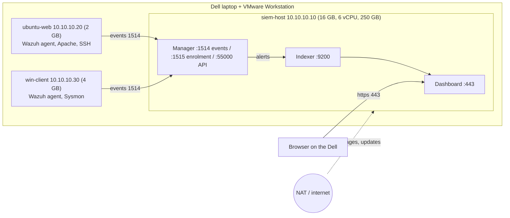

# Week 1 architecture

## Diagram

Host-only network: `10.10.10.0/24`. Only siem-host has a second adapter (NAT).

## Address table

| Machine | IP | Role | RAM | vCPU | Disk | Adapters |
|---|---|---|---|---|---|---|
| siem-host | 10.10.10.10 | Wazuh (Docker) | 16 GB | 6 | 250 GB | Host-only, NAT |
| ubuntu-web | 10.10.10.20 | Linux endpoint, Apache, SSH | 2 GB | 2 | 40 GB | Host-only |
| win-client | 10.10.10.30 | Windows endpoint, Sysmon | 4 GB | 2 | 80 GB | Host-only |

## Ports

| Port | Used for |
|---|---|
| 1514 | Agent events to manager |
| 1515 | Agent enrolment |
| 55000 | Wazuh API |
| 9200 | Indexer |
| 443 | Dashboard (HTTPS) |
